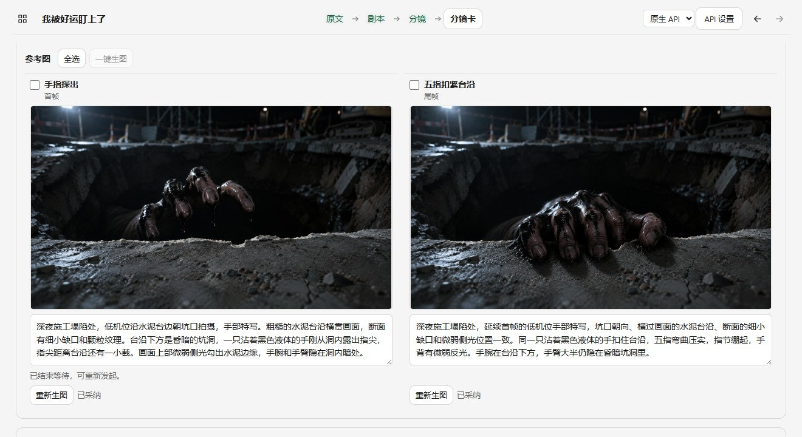
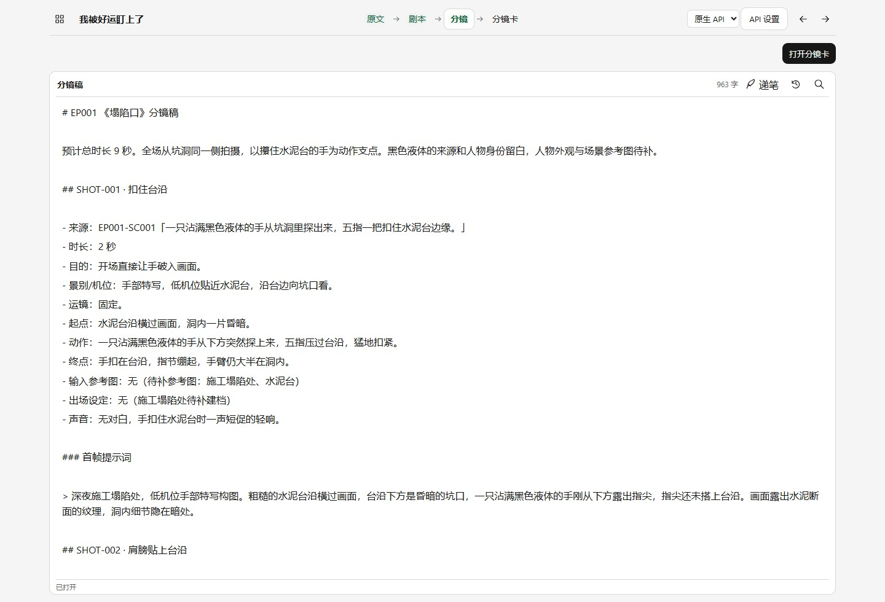
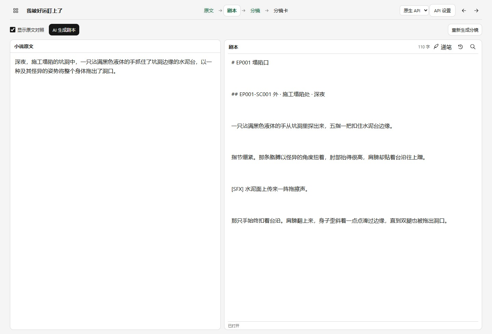

# 递笔漫剧制作

独立的 Codex 本地插件。它把小说片段、剧本、分镜、素材审核和视频任务串在同一个工作流里。

- 新建工作流后可以粘贴小说片段交给 AI 转剧本，也可以手写剧本、选区递笔。
- 拆分镜、编辑候选、管理角色与场景素材。单张场景参考图的设定和提示词可在同页编辑与确认。
- 书架显示最近停留的制作阶段，重新打开可继续之前的审核或制作任务。
- 图片由 Codex 生成。视频可选择 TapNow 或 Seedance 官方接口，生成前需要确认。

## 界面预览

以下截图来自本地开发版 v0.8.0，使用《我被好运盯上了》工作流。

### 分镜卡与首尾帧

在同一张分镜卡中并排查看已采纳的首帧和尾帧，并编辑各自的生图提示词。



<details>
<summary>查看分镜稿与原文／剧本对照</summary>

### 分镜稿



### 原文与剧本对照



</details>

## 本地安装

需要 Node.js 22 或更新版本、Git，以及支持本地 MCP 插件的 Codex。下列命令在克隆后的仓库目录运行。

```sh
npm ci
npm run build
codex plugin marketplace add .
codex plugin add dibi-drama@dibi-drama-local
```

在 Codex 中输入「打开漫剧工作流」。测试可运行 `npm test`。

默认数据目录为用户主目录下的 `.dibi-drama/码字工作台/`。如果要继续使用旧数据，请在构建前把 `WORKBENCH_WORKSPACE` 设为原有「码字工作台」目录的上一级目录。构建会生成机器本地的 MCP 配置，插件读取目录里的现有项目。

智能改编使用 `short-drama-write` 技能。生图、同步和视频任务取决于宿主是否提供相应工具，以及用户配置的服务权限。
